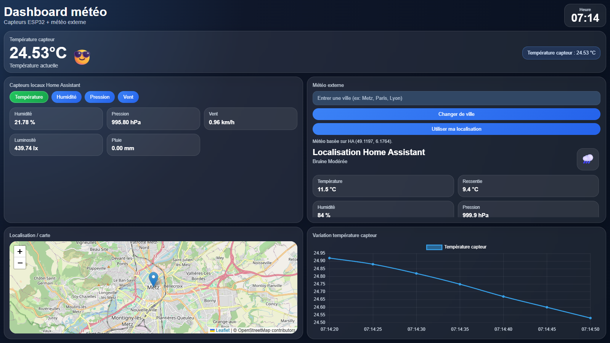
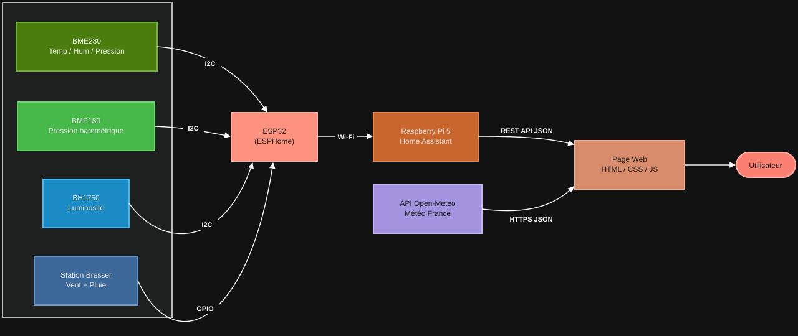
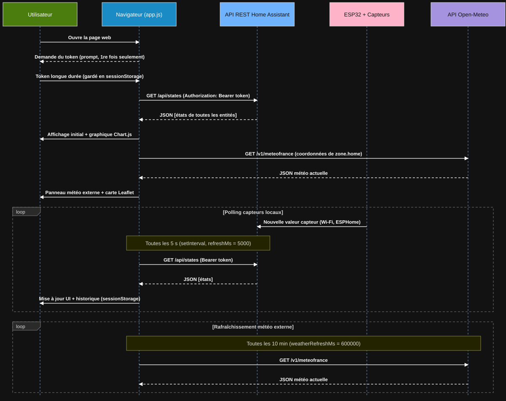
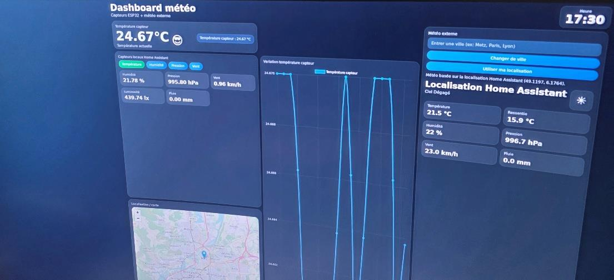

# Home Assistant weather station

[](https://github.com/amine-belkacem/home-assistant-weather-station/actions/workflows/ci.yml)

A single-page web dashboard (HTML, CSS, vanilla JavaScript) that reads the sensors of an ESP32 weather station through the Home Assistant REST API and puts them next to the official Météo-France data from Open-Meteo. No framework and no backend of my own: the page talks to Home Assistant directly from the browser.



## Project context

This comes from the embedded architectures lab of my M1 CSEC at Université de Lorraine (2025-2026). The lab was a connected weather station built by 10 students split into groups: sensors and ESP32 (ESPHome), Home Assistant on a Raspberry Pi 5, and the web interface.

I was in the web group. I wrote the dashboard in this repository and spent most of my time making it reliable. I also helped test and integrate the BME280 and BH1750 sensors and the Bresser wind/rain station, and I set up the shared GitHub repository the web group used during the lab. The ESP32 firmware and the Home Assistant configuration were written by the other groups, so they are not included here.

## Why a plain JavaScript client?

Home Assistant already exposes a REST API with token authentication, so I didn't need a server in the middle. A PHP or Node backend would only have relayed the same JSON. Calling `/api/states` straight from the browser with `fetch()` kept the whole thing to three static files that Home Assistant itself can serve.

The first version worked, but it had the usual problems of a first version: the access token was hard-coded in `app.js` (and therefore on GitHub), a request that never answered froze the page, and the chart history was lost on every refresh. Fixing those was the interesting part of the project.

## Architecture



The sensors (BME280, BMP180 and BH1750 on I2C, the Bresser wind/rain station on GPIO) go to the ESP32, which sends the values over Wi-Fi to Home Assistant. The dashboard polls `GET /api/states` every 5 s and asks Open-Meteo for the current weather at the Home Assistant location every 10 min.



| Part | File | What it does |
|---|---|---|
| Layout | `src/index.html` | Semantic sections, ARIA live regions on the values that change, scripts loaded with `defer`, `preconnect` to the CDNs and APIs |
| Style | `src/style.css` | CSS variables for the theme, `clamp()` font sizes, 2×3 grid that collapses to one column under 1100 px and adapts again under 650 px, `prefers-reduced-motion` |
| Config and token | `src/app.js` | Entity IDs in a frozen `CONFIG`; the token is asked once with `prompt()` and kept in `sessionStorage`, never written in the code |
| Network | `src/app.js` → `safeFetch()` | Every request has an 8 s timeout (`AbortController`) and 2 retries with exponential backoff (500 ms, then 1 s) |
| Data | `src/app.js` → `loadAllStates()`, `updateUI()` | Turns the `/api/states` list into a `Map`, formats values, handles `unknown` / `unavailable` |
| Chart | `src/app.js` + Chart.js | Last 40 points of temperature, humidity, pressure and wind, saved in `sessionStorage` so a page refresh doesn't wipe them; animations off |
| External weather | `src/app.js` + Open-Meteo | Météo-France model at the HA location or at any city (geocoding results cached in a `Map`, search debounced) |
| Map | `src/app.js` + Leaflet | OpenStreetMap tiles, marker on the current location |
| Demo server | `tools/mock-ha-server.js` | Fake Home Assistant: serves `src/` and answers `/api/states` with the values I read during the lab, so the dashboard can run anywhere |

## Results

The dashboard ran on the lab's Raspberry Pi with the real sensors. Values refresh every 5 s without reloading the page. This is the screen at the end of the lab:



At that moment, the station and Open-Meteo gave:

| Quantity | Station (Home Assistant) | Open-Meteo (Météo-France) |
|---|---|---|
| Temperature | 24.67 °C | 21.5 °C |
| Humidity | 21.78 % | 22 % |
| Pressure | 995.80 hPa | 996.7 hPa |
| Wind | 0.96 km/h | 23.0 km/h |

Pressure and humidity agree closely. The temperature and wind gaps most likely come from where the station sat during the test, while Open-Meteo models open-air conditions. Spotting that kind of offset is exactly why I added the comparison panel, but this is a single snapshot, not a calibration.

The screenshot at the top of this page is the same code running against `tools/mock-ha-server.js` (fake sensor values, live Open-Meteo data).

## Repository structure

```
home-assistant-weather-station/
├── src/                     dashboard (index.html, style.css, app.js)
├── tests/                   automated tests (node:test)
├── tools/mock-ha-server.js  fake Home Assistant for the demo and the tests
├── docs/                    figures, screenshots and the lab report (French)
└── .github/workflows/       CI running the tests on every push
```

## How to run

You need Node.js 18 or newer. Nothing to install with npm.

**Demo without a weather station**

```bash
node tools/mock-ha-server.js
```

Open http://localhost:8123 and paste `demo-token` when the page asks for the token.

**Tests**

```bash
node --test tests/app.test.js
```

13 tests run `src/app.js` unchanged inside a sandbox with a fake DOM and a scripted `fetch`: value formatting, emoji thresholds, the 40-point history, the timeout and retry logic of `safeFetch`, and a full round trip through the demo server. They found one real bug: a `moisture` rain sensor reporting `off` (dry) was displayed as "Oui". The same command runs on every push in GitHub Actions.

**With a real Home Assistant**

1. Copy the three files of `src/` into `/config/www/dashboard/` on the Home Assistant machine.
2. Change the entity IDs in `CONFIG.homeAssistant.entities` (top of `app.js`) to match your sensors.
3. Open `http://homeassistant.local:8123/local/dashboard/index.html`.
4. Paste a long-lived access token (Profile → Security → Long-lived access tokens).

Serving the page from Home Assistant keeps it on the same origin as the API, so the relative `/api/states` calls work without any CORS setup.

## Limitations and possible improvements

- **Polling, not push.** The page asks for every state every 5 s even when nothing changed. Home Assistant's WebSocket API (`subscribe_events` on `state_changed`) would be the right next step.
- **Token handling is still basic.** `sessionStorage` is better than a hard-coded token, but any script running on the page can read it, and `prompt()` is not a login screen. A small proxy keeping the token server-side would be cleaner.
- **Entity IDs are hard-coded.** If Home Assistant renames a sensor (`_2` suffix, which happened during the lab), the matching card shows N/A until the config is edited.
- **Short history.** The chart keeps 40 points (about 3 minutes at 5 s) and only for the current tab. The `/api/history` endpoint could load the real history on startup.
- **The chart auto-scales.** With `beginAtZero: false`, a 0.01 °C wobble fills the whole height, as you can see in the lab screenshot. A minimum Y range per quantity would make it easier to read.
- **Requests can overlap.** `setInterval` fires every 5 s, while a request can take up to about 25 s with timeouts and retries. Chaining refreshes with `setTimeout` after each answer would avoid that.
- **Third-party CDNs.** Chart.js and Leaflet come from jsDelivr and unpkg, so the page needs internet access even on a local network.

## Author

**Mohamed Amine Belkacem**, engineering student, M2 Systèmes électroniques et communicants, Université de Lorraine

- GitHub: [amine-belkacem](https://github.com/amine-belkacem)
- LinkedIn: [Mohamed Amine Belkacem](https://www.linkedin.com/in/mohamed-amine-belkacem-262582391)
